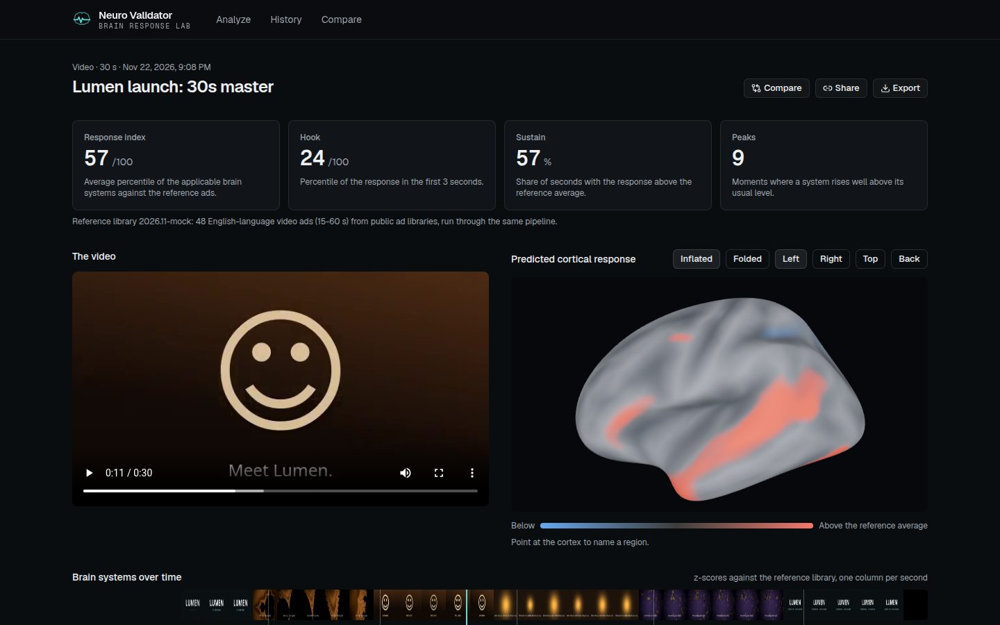
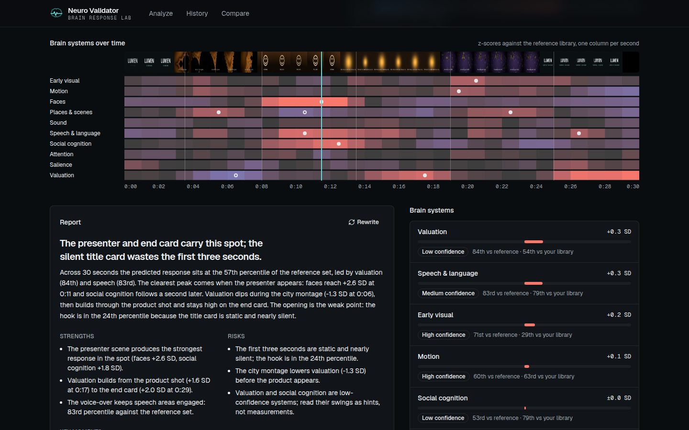
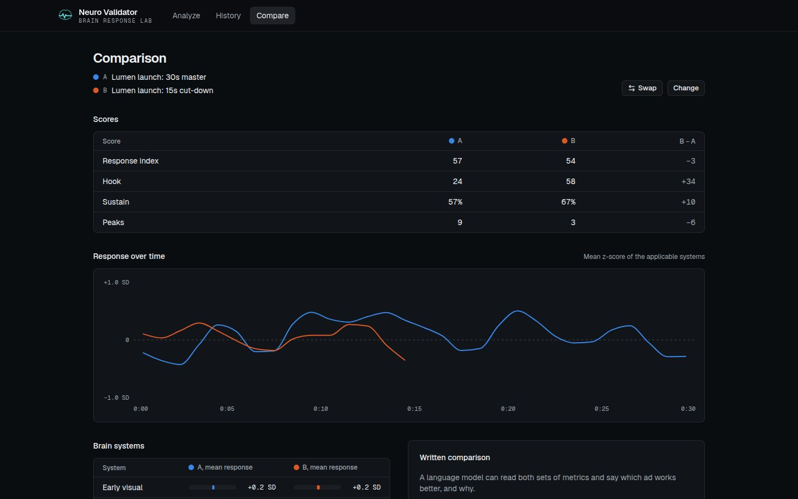

# Neuro-Marketing Validator

[](https://github.com/wolfomania/AI-Neuro-Marketing-Validator/actions/workflows/ci.yml)

See how an average viewer's brain would respond to an ad, second by second,
before you run it.

Upload a video, an audio spot, or a script. TRIBE v2, Meta FAIR's brain
encoding model, predicts the response of the cortex. The app turns that
prediction into ten brain systems, headline scores against reference ads, the
moments that stand out, and a written report with recommendations.



## What you get

- **A cortical response for every second.** TRIBE v2 predicts the fMRI
  response at 20,484 points of the cortex from what the clip shows, sounds
  like, and says. A 3D brain plays it back in sync with the video.
- **Ten brain systems, with honest confidence.** Early visual, Motion, Faces,
  Places & scenes, Sound, Speech & language, Social cognition, Attention,
  Salience, and Valuation, each a set of HCP-MMP1.0 areas labeled high,
  medium, or low confidence.
- **Scores against reference ads.** Response index, Hook (the first 3
  seconds), Sustain, and Peaks, plus each system's percentile among the
  reference ads and among your own analyses. The scores need a reference
  library, which the repository does not ship yet; without one, each clip is
  compared with itself ([details](docs/science.md#comparing-with-reference-ads)).
- **A timeline of moments.** A heatmap of every system over time, with peaks
  and dips marked under the scene thumbnails. Click anywhere to jump there.
- **A written report from the model you choose.** Gemini, Claude, OpenAI, or
  any other model [Pydantic AI](https://ai.pydantic.dev/) supports. It watches
  the clip when the model accepts video (Gemini does) and looks at scene
  keyframes otherwise, explains the numbers, and ties each recommendation to a
  moment. The report is optional: the metrics stand on their own.
- **History, A/B comparison, and sharing.** Compare two cuts side by side with
  a written comparison, share a read-only link, and export a standalone HTML
  report, a PDF, or the raw data.
- **Easy to run.** Locally without a GPU, or on [Modal](https://modal.com)
  with one command. Every part scales to zero when idle.



## Try it locally

You need [uv](https://docs.astral.sh/uv/), Node.js 22.12 or later with pnpm
(`corepack enable`), and ffmpeg. uv installs Python 3.12 if it is missing.

```sh
git clone https://github.com/wolfomania/AI-Neuro-Marketing-Validator.git
cd AI-Neuro-Marketing-Validator
cp .env.example .env
make install
make dev
```

`make dev` starts the API on port 8000 and the app on
<http://localhost:5173>. Locally the brain is a mock that makes deterministic,
synthetic responses, so no GPU is needed; everything else is real. To get
written reports, set `NM_LLM_MODEL` and its key in `.env`.

To try the interface alone, `make dev-ui` serves the app with a mock API in
the browser: seeded analyses, reports, and a reference library, without Python
or ffmpeg. The screenshots on this page come from it.

## Deploy on Modal

```sh
cp .env.example .env   # set HF_TOKEN; optionally NM_LLM_MODEL, its key, NM_PASSWORD
make deploy
```

The first deploy downloads about 20 GB of models into a Modal Volume and
builds the images; later deploys reuse both. The GPU worker (an L4 by
default, $0.80 per hour) runs only while there is work and for 10 idle
minutes after. `NM_GPU=L40S make deploy` picks a faster GPU ($1.95 per hour).
See [docs/deploy.md](docs/deploy.md) for the details, costs, and operations.

## Configuration

Settings come from `.env` (see [.env.example](.env.example)). All are
optional except `HF_TOKEN` for a Modal deployment.

| Setting | Default | What it does |
|---|---|---|
| `NM_LLM_MODEL` | none | The report model, such as `google:gemini-4-hydrogen` or `anthropic:claude-opus-5-5`. Empty: no written reports. |
| `GOOGLE_API_KEY`, `ANTHROPIC_API_KEY`, `OPENAI_API_KEY` | none | The key for the provider in `NM_LLM_MODEL`. |
| `NM_LLM_MEDIA` | `video` | What the report model sees besides the metrics: `video` (the clip, when the model accepts it), `keyframes` (up to 16 scene frames), or `text` (nothing else). |
| `NM_LLM_OUTPUT_MODE` | `tool` | How the model returns the report: `tool`, `native`, or `prompted`. |
| `NM_PASSWORD` | none | Require a login. Share links still work without one. |
| `NM_SECRET_KEY` | generated | Signs sessions and share links. If empty, a random key is kept in storage. |
| `NM_SESSION_DAYS` | `30` | How long a login lasts. |
| `HF_TOKEN` | none | A Hugging Face token whose account accepted the Llama 3.2 license; Modal uses it to download the models. |
| `NM_BRAIN_BACKEND` | `mock` | Local only: `mock`, `replay` (a recorded TRIBE v2 run), or `tribe` (needs a GPU). Modal always uses `tribe`. |
| `NM_MIN_DURATION_S`, `NM_MAX_DURATION_S`, `NM_MAX_UPLOAD_MB` | `3`, `180`, `500` | Upload limits. |

Data leaves your deployment in two places. The report model's provider
receives the metrics and, depending on `NM_LLM_MEDIA`, the clip or its
keyframes; some providers' free tiers may use such data to improve their
products. Scripts go to Google Translate's text-to-speech service, through
gTTS, to be read aloud.

## How it works

Uploads become analyses that a background job carries through four stages:
prepare the media, predict the cortical response on a GPU, measure the
systems and scores, and write the report. One FastAPI app serves the API and
the React app.

- [docs/architecture.md](docs/architecture.md): the parts, the data, and the
  tests, with a diagram.
- [docs/science.md](docs/science.md): how each number is computed, the
  systems and their sources, the limitations, and the licenses.
- [docs/api.md](docs/api.md): the HTTP API.
- [docs/deploy.md](docs/deploy.md): deploying and running on Modal.



## Development

```sh
make test                                  # backend and frontend tests
make lint                                  # ruff, mypy, ESLint, and tsc
pnpm --dir frontend check                  # everything CI checks in the frontend
pnpm --dir frontend exec playwright install chromium
pnpm --dir frontend e2e                    # end-to-end tests in Chromium
```

| Folder | Content |
|---|---|
| `backend/` | The FastAPI app, the pipeline, and the analysis (Python 3.12, uv) |
| `frontend/` | The React app (TypeScript, pnpm) |
| `deploy/modal_app.py` | The Modal app: web tier, job runner, and GPU worker |
| `docs/` | Architecture, science, API, and deployment |

## Limitations

The numbers are predictions for an average viewer, not measurements of real
people. They do not capture individual differences, memory, liking, or
purchase intent, and they do not forecast sales. Treat them as hypotheses to
test. TRIBE v2 was trained on English, so other languages are less reliable,
and the low-confidence systems are hints rather than measurements. See
[docs/science.md](docs/science.md#limitations).

## Licenses of the models and data

TRIBE v2's weights are licensed CC BY-NC 4.0: non-commercial use only. Llama
3.2 has its own license, which your Hugging Face account accepts. The
HCP-MMP1.0 atlas data are redistributed under the WU-Minn HCP Open Access Data
Use Terms; the required acknowledgment is in
[backend/src/neuromarketing/data/README.md](backend/src/neuromarketing/data/README.md).
