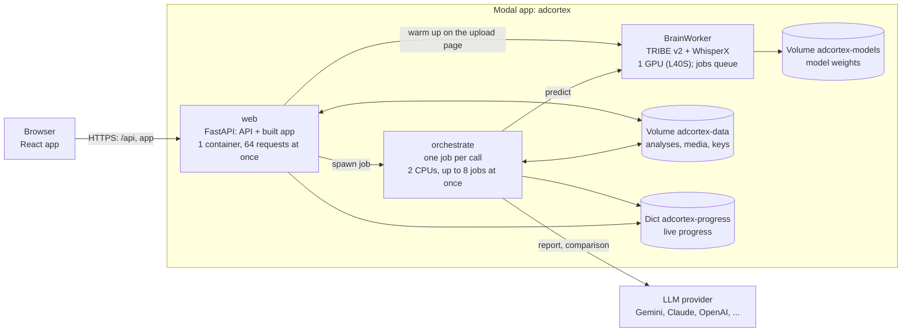

# Architecture

This page describes how the app is put together: the parts that run, how an
analysis flows through them, where data lives, and how the code is tested. For
the method behind the numbers, see [science.md](science.md); for the HTTP
contract, [api.md](api.md); for deployment, [deploy.md](deploy.md).

## Overview

One FastAPI app serves both the API and the built React app. Uploads become
analyses that a background job carries through four stages; the one stage
that needs a GPU runs on a separate worker. The same code runs locally, with
everything in one process, or on Modal, where each part scales to zero.



Locally (`ADCORTEX_RUNTIME=local`), the same parts are function calls in one
process: jobs run in-process, storage is a folder (`.adcortex-data/`), progress is
kept in memory, and the brain backend is a mock, a replay of a recorded run,
or the real model on a local GPU (`ADCORTEX_BRAIN_BACKEND`).

## An analysis, step by step

1. **Upload** (`api/uploads.py`). The web tier probes the upload with ffprobe
   and rejects a wrong track type or a clip outside the limits (3–180 s and
   500 MB by default) before anything is stored. It then stores the media and
   `meta.json` and starts a job (`jobs/`).
2. **Prepare** (`pipeline/prepare.py`). ffmpeg makes a 720p preview, which the
   player shows and the brain model sees, then finds scene cuts and extracts
   keyframes, a thumbnail strip, a loudness envelope, and a small proxy for
   the report model. Audio becomes a preview and a 16 kHz WAV. A script is
   first read aloud with gTTS, then handled as audio.
3. **Predict** (`pipeline/predict.py`). The GPU worker transcribes the speech
   with WhisperX and runs TRIBE v2, with its video model in float16 and each
   video frame decoded once ([benchmarks](benchmarks.md)). Identical input
   (same SHA-256) reuses the finished prediction of an earlier analysis
   instead.
4. **Measure** (`pipeline/measure.py`). CPU code turns the prediction into
   system curves, scores, moments, per-scene statistics, library percentiles,
   and the per-second brain maps (`analysis/`).
5. **Interpret** (`pipeline/interpret.py`). If a model is configured, the
   report agent writes the report. A failure here leaves the metrics intact,
   and the report can be rewritten later.

While a job runs, the UI polls `GET /api/analyses/{id}/status`. Each stage
writes its state to storage; the live percentage within a stage goes to the
progress store. If a job dies, the next status poll marks the analysis failed
(`jobs/monitor.py`), and the user can retry it.

## Where data lives

An analysis is a folder of JSON documents and media (`storage/repository.py`):

```text
analyses/<id>/meta.json      name, kind, options       written by the web tier
analyses/<id>/state.json     stage and status          written by the pipeline
analyses/<id>/job.json       the job that runs it      written by the dispatcher
analyses/<id>/result.json    metrics                   written by the pipeline
analyses/<id>/report.json    the written report        written by the pipeline
analyses/<id>/<artifact>     media, keyframes, brain frames, raw prediction
fingerprints/<sha256>        id of a finished analysis of identical input
comparisons/<a>--<b>.json    a written A/B comparison
```

Each document has a single writer, so containers never overwrite each other's
changes. Ids start with their creation time, so listing folder names sorts the
history without reading any document.

The brain maps are one byte per vertex per second (20,484 vertices), served as
raw bytes from `GET /api/analyses/{id}/frames`: about 0.6 MB for a 30-second
clip before gzip.

## The frontend

- **Stack:** React 19, Vite 8, TypeScript, Tailwind CSS v4 with shadcn/ui
  components, TanStack Router (file routes in `frontend/src/routes/`) and
  TanStack Query.
- **Pages:** upload (`/`), an analysis with live progress and results
  (`/a/$id`), history (`/history`), A/B comparison (`/compare`), a read-only
  share view (`/s/$token`), and the login page (`/login`).
- **API client:** types are generated from the backend's OpenAPI schema
  (`pnpm gen:api`), so a contract change fails the type-check.
- **3D brain:** react-three-fiber draws the fsaverage5 mesh (`public/brain/`,
  inflated and folded surfaces) and colors each vertex from the brain map at
  the video's playhead. It renders on demand, not every frame.
- **Load time:** each route is its own chunk. The 3D view and three.js load
  only on the results page, and the upload page must stay under 150 kB of
  gzipped JavaScript (`scripts/check-size.mjs`).
- **Mock API:** in development, Mock Service Worker serves seeded analyses in
  the browser (`src/mocks/`), so the whole app runs without a backend. Add
  `?mock=password,nobaseline,fail,...` to the URL to reach other states
  (`src/mocks/scenario.ts`).

## Security

- **Password (optional).** With `ADCORTEX_PASSWORD` set, every API route except
  health, config, login, and share links needs a session cookie
  (`adcortex_session`, `api/middleware.py`): HttpOnly, HMAC-signed, and valid for
  `ADCORTEX_SESSION_DAYS` (30 by default). Its signature covers a digest of the
  password, so changing the password signs everyone out. Login attempts are
  limited to 5 per minute per client address.
- **Share links** carry a signed token with an expiry (30 days). They grant
  read-only access to one analysis.
- **Signing key.** `ADCORTEX_SECRET_KEY`, or a random key generated once and kept in
  storage (`keys/signing.key`).
- **Headers.** Every response carries `X-Content-Type-Options: nosniff`,
  `Referrer-Policy: no-referrer` (share tokens live in URLs), and
  `X-Frame-Options: DENY`. The app is served with a Content Security Policy
  that allows only same-origin scripts and connections (`api/frontend.py`).
- **Uploads** are checked by type, size, and ffprobe metadata before any job
  starts; ffmpeg runs with fixed argument lists, never through a shell
  (`media/ffmpeg.py`).
- **Exported reports** are single HTML files with a CSP of
  `default-src 'none'`: they run no script and load nothing from the network.

## Tests

| Layer | Tools | What runs |
|---|---|---|
| Backend | pytest, ruff, strict mypy | Unit and integration tests with fake brain and LLM backends (Pydantic AI `TestModel`/`FunctionModel`); ffmpeg tests make their own media. Coverage gate: 80%. |
| Frontend | Vitest, Testing Library, MSW | Components and pages against the mock API. Coverage gates: 80% statements, functions, and lines; 75% branches. |
| End-to-end | Playwright | Upload, results, history, compare, export, password, and phone layout in Chromium against the mock API. |

GitHub Actions runs all three on every pull request
(`.github/workflows/ci.yml`). None of them needs a GPU, a Modal account, or an
LLM key.
